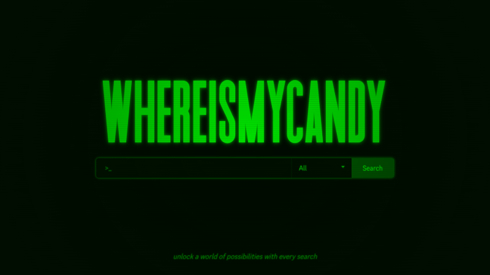

# 🔍 FindMyCandy  

<p align="center">

</p>

A revolutionary web tool that unveils hidden open directories across the internet!
**FindMyCandy** provides a sleek, retro-themed terminal interface for discovering open directories using Google.  


## ✨ Features  

- 🧠 **Intelligent Directory Search**: Discover massive archives of content other search engines can't find!
- 🎯 **Smart File Type Detection**: Automatically identifies and categorizes content types for precision searching
- 🔄 **Advanced Filtering System**: Filter searches by videos, music, images, documents, books, archives, code, software, Google Drive, and Open FTP
- 📡 **Open FTP Search**: Dedicated mode for finding open FTP servers
- 🛡️ **Clean Results**: Automatically filters out generic web pages (php, html) to show only true open directories
- 🎨 **Retro Terminal UI**: Eye-catching retro-themed interface with CRT scanlines and screen glow, designed for nostalgic search sessions
- 💬 **Dynamic Message Carousel**: Rotating inspirational and mysterious search messages to enhance your experience
- 📱 **Seamless Device Adaptation**: Perfectly optimized for all devices from desktop to mobile
- 🚀 **Lightning-Fast Results**: Get instant access to vast libraries of content with a single search
- 🕵️ **Zero-Trace Searching**: Your searches remain completely private

## 📂 Directory Structure  

```
🌟 FindMyCandy/
├── 🖼️ assets/
│   ├── cursor.svg                 # Custom retro cursor
│   ├── favicon.ico                # Website favicon
│   ├── github.svg                 # GitHub social icon
│   └── title.svg                  # SVG Title logo
│
├── 📜 scripts/                    # Modular JavaScript logic
│   ├── constants.js               # Configuration & file mapping
│   ├── dropdown-ui.js             # Custom dropdown component
│   ├── font-loader.js             # Font loading utility
│   ├── main.js                    # Application entry point
│   ├── message-carousel.js        # Dynamic text typing effect
│   ├── messages.js                # Carousel text data
│   └── search-engine.js           # Google Dork query generation
│
├── 🎨 styles/                     # Modular CSS stylesheets
│   ├── animations.css             # Keyframe animations (glitch, blur)
│   ├── button.css                 # Search button styling
│   ├── crt-effects.css            # Scanlines, glow, curvature
│   ├── dropdown.css               # Custom dropdown styling
│   ├── github-link.css            # Footer link styling
│   ├── input.css                  # Search input styling
│   ├── layout.css                 # Core flexbox layout
│   ├── main.css                   # Central CSS import file
│   ├── message-carousel.css       # Typing text styling
│   ├── reset.css                  # CSS Reset & base styles
│   ├── responsive.css             # Mobile & Tablet adaptations
│   ├── scrollbar.css              # Custom scrollbars
│   └── variables.css              # Global CSS variables (colors, fonts)
│
├── .gitignore                     # Git ignore file
├── index.html                     # Main HTML structure
├── README-img.png                 # Project screenshot
└── README.md                      # Project documentation
```
---

## 📄 Getting Started  

Follow these simple steps to unlock the power of FindMyCandy on your system:  

### 1️⃣ Clone the Repository  
Clone the repository to your local machine:  
```bash
git clone https://github.com/yashthorat7/FindMyCandy.git
```

### 2️⃣ Opening the Application  
No complex setup required! Simply open index.html in your browser:
```bash
# Navigate to the directory
cd FindMyCandy

# On Windows
start index.html

```

## 🛠️ How to Use  

1. Type your search query in the input field
2. Select a file type filter from the dropdown (or leave as "All")
3. Click the "Search" button or press Enter
4. Discover a world of hidden content in a new tab using Google's advanced search algorithms

---

## 🔍 Advanced Search Capabilities  

- 🎬 **Videos**: Uncover vast libraries of MP4, MKV, AVI, MOV, WMV, FLV, WEBM, MPEG, and many more
- 🎵 **Music**: Discover endless MP3, WAV, FLAC, AAC, M4A, OGG, and other audio treasures
- 🖼️ **Images**: Access massive collections of JPG, PNG, GIF, BMP, WEBP, SVG, and professional formats
- 📄 **Documents**: Find comprehensive archives of PDF, DOC, XLSX, PPT, EPUB, and dozens more document types
- 📚 **Books & Comics**: Huge libraries of EPUB, MOBI, PDF, CBZ, and CBR files
- 📦 **Archives**: Find compressed treasures in ZIP, RAR, 7Z, ISO, and more
- 💻 **Code Repositories**: Locate source code in Python, JavaScript, HTML, CSS, PHP, C++, and other languages
- 💾 **Software**: Locate EXE, MSI, APK, and various other application formats
- 🌐 **Google Drive**: Specialized search for content stored in Google Drive repositories
- 📡 **Open FTP**: Specialized mode for discovering content on open FTP servers

## 📋 Technologies  

- 💻 **HTML5**: Modern semantic structure with optimized performance
- 🎨 **CSS3**: Responsive styling with elegant animations and modular architecture
- 🧩 **JavaScript**: Sophisticated search algorithms with vanilla JS (ES6 Modules)
- 🔤 **Custom Typography**: VT323 font for the distinctive retro terminal styling
- 🔄 **Dynamic Content**: Interactive UI elements that respond to user interaction

## 🚀 Special Features

- 🧠 **Smart Dropdown**: Dynamically adjusts menu height to prevent overlapping with the footer
- 📱 **Mobile Optimization**: Perfect touch controls with solid backgrounds for better readability
- 🔍 **Google Dorking for Precision**: Leverages advanced Google search parameters to find results traditional search misses
- 🌐 **Multi-Platform Support**: Works flawlessly across all modern browsers

## ❤️ Developed By  

👨‍💻 **Yash Thorat**  
Feel free to suggest improvements or report issues!  

⭐ Don't forget to **star** this repository if you find it useful!
